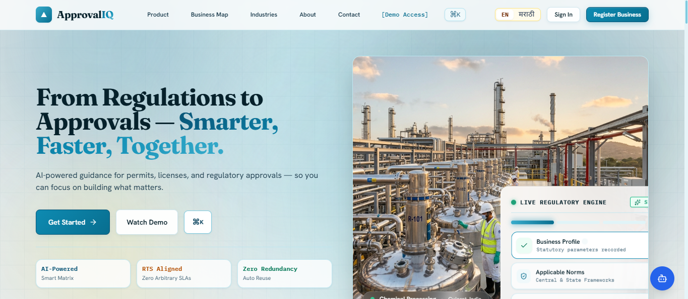
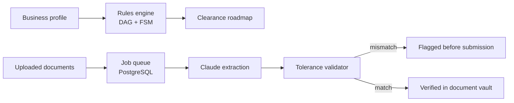
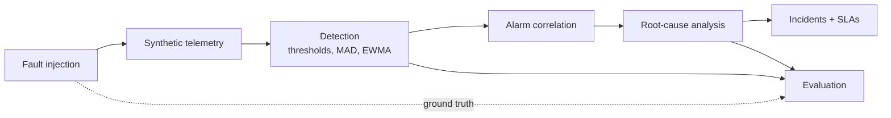

<h1 align="center">Shreya Sherikar</h1>

<i>Architecture is the discipline of making today's decisions withstand tomorrow's complexity.</i>

  <b>Backend &amp; AI developer</b> · Final-year B.Tech CSE, Amity University Bengaluru 
  I build systems where correctness matters: rules engines, concurrency, and LLM pipelines with guardrails.

  
  
  

  <a href="https://www.linkedin.com/in/shreya-sherikar">LinkedIn</a> ·
  <a href="mailto:shreyasherikar18@gmail.com">Email</a> ·
  <a href="assets/Shreya_Sherikar_Resume.pdf">Resume (PDF)</a>

---

## At a glance

| Project | What it is | Built with |
|---|---|---|
| **[ApprovalIQ](https://github.com/shreysherikar/Approval-IQ)** | Regulatory clearance orchestration with AI document verification. [Live](https://approval-iq-web.vercel.app/) | TypeScript · NestJS · React · PostgreSQL |
| **[NEXUS](https://github.com/shreysherikar/Nexus)** | Network incident management: fault simulation, detection, root-cause analysis, SLAs | Python · FastAPI · React · PostgreSQL |
| **[Scasi AI](https://github.com/shreysherikar/Scasi_AI)** | Multi-agent email assistant with RAG search. [Live](https://scasiaiworks-ev3y.vercel.app/) | Next.js · Supabase · pgvector · LLM APIs |
| **[ThreadForge](https://github.com/shreysherikar/ThreadForge)** | Multithreaded priority task scheduler | C++17 · CMake · GoogleTest |
| **[forge](https://github.com/shreysherikar/forge)** | AI-assisted engineering CLI: plan, review, docs and commit workflows with a test-gated ship pipeline | Python |

## How I build

- **Separation of judgment.** In ApprovalIQ, Claude extracts the fields and plain code decides whether they match.
- **Honest evaluation.** NEXUS's detectors never see the injected faults they're scored against.
- **Measured performance.** ThreadForge is benchmarked across CPU-bound and I/O-bound workloads to show where parallelism pays off.

**Currently:** extending NEXUS with Prometheus metrics export and Grafana dashboards.

---

## Featured projects

### ApprovalIQ · regulatory clearance orchestration
*Team of 4 · 1st Runner-up, Smart India Hackathon 2026 (internal round) · [Live demo](https://approval-iq-web.vercel.app/) · [Source](https://github.com/shreysherikar/Approval-IQ) · [Architecture docs](https://github.com/shreysherikar/Approval-IQ/tree/HEAD/docs/architecture)*

Setting up a plant in India means clearing a dozen overlapping government bodies, and many of those approvals depend on each other. ApprovalIQ models that as a dependency graph, tells a business what to file and in what order, and checks their documents before submission.

- **Rules engine as pure functions.** Approval dependencies are a DAG, ordered with topological sort and cycle detection, with clearance state tracked by a finite state machine. No database access inside the engine, so every evaluation is reproducible.
- **LLM extraction with a deterministic validator.** Claude extracts fields from uploaded documents. A separate comparator checks them against the declared facility profile (for example, ±1% on plot area).
- **Job queue without extra infrastructure.** Document extraction runs on a PostgreSQL queue using `FOR UPDATE SKIP LOCKED`, with retries and backoff, instead of adding Redis or a broker.
- **Mock provider for CI.** A fixture-backed extraction provider keeps the 115-test suite deterministic and free of API calls.
- **One codebase, three targets:** web, Windows desktop (Tauri/Rust) and Android (Capacitor).

`TypeScript` `NestJS` `React` `PostgreSQL` `Prisma` `Claude API` `Tauri` `Capacitor` · pnpm monorepo, 12 packages, 28 data models

---

### NEXUS · network incident management platform
*Solo project · [Source](https://github.com/shreysherikar/Nexus)*

A telecom network operations platform with its own simulation engine, so it needs no live carrier feeds or hardware. It generates telemetry, injects faults, detects anomalies, correlates alarms, diagnoses root causes, and tracks incidents against SLAs.

- **Hierarchical network model** (Core → Aggregation → Site → Cell) with validation, cycle detection and a transport-link layer.
- **Detection with no access to ground truth.** Threshold rules with hysteresis, plus rolling-median (MAD) and EWMA statistical detectors, run without importing the injected-fault records.
- **Alarm correlation and explainable root-cause analysis.** Alarms are clustered using the topology, with lowest-common-ancestor resolution. Rule-based diagnosis scores evidence and reports its sources.
- **Benchmarked against ground truth.** Precision, recall, F1, mean time to detect, and root-cause accuracy are computed per scenario.
- **Incident lifecycle with SLAs:** state machine, audit timeline, MTTA/MTTR, a FastAPI REST + WebSocket backend and a React operations dashboard.

`Python` `FastAPI` `SQLAlchemy` `Alembic` `PostgreSQL` `React` `TypeScript` `pytest` `Vitest` · 27-node reference network, 26 transport links, 5 fault scenarios, 8 detection rules

---

### Scasi AI · multi-agent email assistant
*Team of 4 · 2nd Runner-up, AlgosQuest 2025 AI/ML Hackathon · [Live demo](https://scasiaiworks-ev3y.vercel.app/) · [Source](https://github.com/shreysherikar/Scasi_AI)*

An email assistant that classifies, summarizes, prioritizes and drafts replies, coordinated by an orchestrator agent.

- **Agent pipeline:** classify → summarize → extract tasks → draft reply → detect follow-ups.
- **RAG search:** hybrid vector + full-text retrieval over pgvector.
- **LLM routing layer:** multi-provider routing with fallback, response caching and rate limiting.
- **Eval harness:** LLM-as-judge scoring over versioned prompts.

`Next.js` `TypeScript` `Supabase` `pgvector` `Groq` `Gemini` `OpenRouter`

---

### ThreadForge · multithreaded priority task scheduler
*Solo project · [Source](https://github.com/shreysherikar/ThreadForge) · [Design docs](https://github.com/shreysherikar/ThreadForge/tree/HEAD/docs)*

A C++17 task scheduler: priority queue, fixed worker pool, typed futures and a defined shutdown contract.

- **Strict ordering:** four priority levels, with FIFO tie-breaking through a monotonic sequence number.
- **Thread safety by design:** predicate-based condition variables, tasks run outside the locks, exception isolation, and detection of worker self-joins.
- **Benchmarked across workload classes:** **4.26×** speedup on ~120 µs CPU tasks and **7.88×** on latency-bound tasks, on 8 cores.
- 31 unit tests, zero compiler warnings, and ASan/TSan configured in CI.

`C++17` `CMake` `GoogleTest` `GitHub Actions`

---

### forge · AI-assisted engineering CLI
*Solo project · [Source](https://github.com/shreysherikar/forge)*

A command-line tool that handles the text-heavy parts of an engineering workflow (planning, code review, doc updates, commit messages, project scaffolding) with a separate LLM assigned to each role.

- **Role-based model routing:** plan, review, docs and commit roles each map to a configurable model through OpenAI-compatible provider endpoints, with a live check of each key as it is configured.
- **Test-gated shipping:** `forge ship` runs tests, review, docs, commit and push in order, and never pushes when tests fail.
- **Stack-aware testing:** detects and runs pytest, npm (Vitest/Jest), cargo or go test suites.
- **Deliberate scope:** it does not write multi-file code, leaving that to editors with diff preview and undo; the README explains the boundary.

`Python` `CLI` `LLM APIs` `Git` `GitHub CLI`

---

## Hackathons

- **EY Techathon 5.0:** Semi-finalist.
- **AlgosQuest 2025, AI/ML Hackathon (iSource Technologies):** 2nd Runner-up, with Scasi AI (team of 4).
- **Smart India Hackathon 2026, internal round:** 1st Runner-up, with ApprovalIQ (team of 4).

## Skills

| | |
|---|---|
| **Languages** | Python · TypeScript · C++ · SQL |
| **Backend** | FastAPI · NestJS · REST · WebSockets · job queues · concurrency |
| **AI / LLM** | Claude / Gemini / Groq APIs · RAG · multi-agent orchestration · LLM evaluation |
| **Data** | PostgreSQL · pgvector · SQLAlchemy · Prisma · Alembic |
| **Frontend** | React · Next.js · Tailwind CSS |
| **Tooling** | Docker · GitHub Actions · pytest · Jest · Vitest · CMake |

## Certifications

- AWS Certified Cloud Practitioner
- AWS Certified AI Practitioner

---

<i>Open to full-time backend, AI and software development roles.</i>

