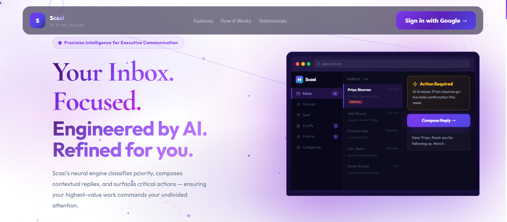

<h1 align="center">Shreya Sherikar</h1>

<i>Correct before clever. Measured before claimed.</i>

  <b>Backend &amp; AI engineer</b> · Final-year B.Tech CSE, Amity University Bengaluru 
  I build systems where correctness matters: rules engines, concurrency, and LLM pipelines with guardrails.

  
  
  

  <a href="https://www.linkedin.com/in/shreya-sherikar">LinkedIn</a> ·
  <a href="mailto:shreyasherikar18@gmail.com">Email</a>

---

## How I build

- **I don't let an LLM grade its own work.** In ApprovalIQ, Claude extracts the fields and plain code decides whether they match.
- **I keep the thing under test blind to the answer.** NEXUS's detectors never see the injected faults they're scored against.
- **I publish the result that makes me look worse.** ThreadForge is slower than sequential on tiny tasks, and the README says so.

**Currently:** extending NEXUS with Prometheus metrics export and Grafana dashboards.

---

## Featured projects

### ApprovalIQ · regulatory clearance orchestration
*Team of 4 · 1st Runner-up, Smart India Hackathon 2026 (internal round) · [Live demo](https://approval-iq-web.vercel.app/) · [Source](https://github.com/shreysherikar/Approval-IQ)*

Setting up a plant in India means clearing a dozen overlapping government bodies, and many of those approvals depend on each other. ApprovalIQ models that as a dependency graph, tells a business what to file and in what order, and checks their documents before submission.

- **Rules engine as pure functions.** Approval dependencies are a DAG, ordered with topological sort and cycle detection, with clearance state tracked by a finite state machine. No database access inside the engine, so every evaluation is reproducible.
- **LLM extraction with a deterministic validator.** Claude extracts fields from uploaded documents. The LLM does not decide whether they match: a separate comparator checks them against the declared facility profile (for example, ±1% on plot area).
- **Job queue without extra infrastructure.** Document extraction runs on a PostgreSQL queue using `FOR UPDATE SKIP LOCKED`, with retries and backoff, instead of adding Redis or a broker.
- **Mock provider for CI.** A fixture-backed extraction provider keeps the 115-test suite deterministic and free of API calls.
- **One codebase, three targets:** web, Windows desktop (Tauri/Rust) and Android (Capacitor).

`TypeScript` `NestJS` `React` `PostgreSQL` `Prisma` `Claude API` `Tauri` `Capacitor` · pnpm monorepo, 12 packages, 28 data models

---

### NEXUS · network incident management platform
*Solo project · [Source](https://github.com/shreysherikar/Nexus)*

A simulation-driven platform for telecom network operations: it generates telemetry, injects faults, detects anomalies, correlates alarms, diagnoses root causes, and tracks incidents against SLAs. All data is synthetic, and the README says so.

- **Hierarchical network model** (Core → Aggregation → Site → Cell) with validation, cycle detection and a transport-link layer.
- **Detection stage with no access to ground truth.** Threshold rules with hysteresis, plus rolling-median (MAD) and EWMA statistical detectors, run without importing the injected-fault records.
- **Alarm correlation and explainable root-cause analysis.** Alarms are clustered using the topology, with lowest-common-ancestor resolution. Rule-based diagnosis scores evidence and reports its sources.
- **Benchmarked against ground truth.** Precision, recall, F1, mean time to detect, and root-cause accuracy are computed per scenario.
- **Incident lifecycle with SLAs:** state machine, audit timeline, MTTA/MTTR, a FastAPI REST + WebSocket backend and a React operations dashboard.

`Python` `FastAPI` `SQLAlchemy` `Alembic` `PostgreSQL` `React` `TypeScript` `pytest` `Vitest`

---

### ThreadForge · multithreaded priority task scheduler
*Solo project · [Source](https://github.com/shreysherikar/ThreadForge)*

A C++17 task scheduler: priority queue, fixed worker pool, typed futures and a defined shutdown contract.

- **Strict ordering:** four priority levels, with FIFO tie-breaking through a monotonic sequence number.
- **Thread safety by design:** predicate-based condition variables, tasks run outside the locks, exception isolation, and detection of worker self-joins.
- **Measured, not assumed.** On 8 cores: **4.26×** speedup on ~120 µs CPU tasks and **7.88×** on latency-bound tasks. On ~3 µs tasks it is *slower* than sequential, because synchronization overhead dominates. The README documents that too.
- 31 unit tests, zero warnings, and ASan/TSan configured in CI.

`C++17` `CMake` `GoogleTest` `GitHub Actions`

---

### Scasi AI · multi-agent email assistant
*Team of 4 · 2nd Runner-up, AlgosQuest 2025 AI/ML Hackathon · [Live demo](https://scasiaiworks-ev3y.vercel.app/) · [Source](https://github.com/shreysherikar/Scasi_AI)*

An email assistant that classifies, summarizes, prioritizes and drafts replies, coordinated by an orchestrator agent.

- **Agent pipeline:** classify → summarize → extract tasks → draft reply → detect follow-ups.
- **RAG search:** hybrid vector + full-text retrieval over pgvector.
- **LLM routing layer:** multi-provider routing with fallback, response caching and rate limiting.
- **Eval harness:** LLM-as-judge scoring over versioned prompts.

`Next.js` `TypeScript` `Supabase` `pgvector` `Groq` `Gemini` `OpenRouter`

---

## Hackathons

- **AlgosQuest 2025, AI/ML Hackathon (iSource Technologies):** 2nd Runner-up. Built Scasi AI with a team of 4.
- **Smart India Hackathon 2026, internal round:** 1st Runner-up. Built ApprovalIQ with a team of 4.

## Skills

| | |
|---|---|
| **Languages** | Python · TypeScript · C++ · SQL |
| **Backend** | FastAPI · NestJS · REST · WebSockets · job queues · concurrency |
| **AI / LLM** | Claude / Gemini / Groq APIs · RAG · multi-agent orchestration · LLM evaluation |
| **Data** | PostgreSQL · pgvector · SQLAlchemy · Prisma · Alembic |
| **Frontend** | React · Next.js · Tailwind CSS |
| **Tooling** | Docker · GitHub Actions · pytest · Jest · Vitest · CMake · AWS (certified) |

## Certifications

- AWS Certified Cloud Practitioner
- AWS Certified AI Practitioner

---

<i>Open to full-time backend, AI and software engineering roles. The best way to reach me is above.</i>

