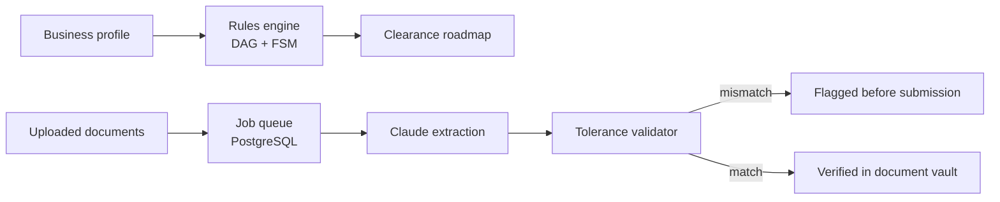
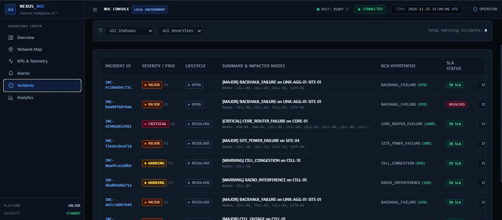
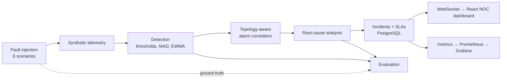

<h1 align="center">Shreya Sherikar</h1>

<i>Architecture is the discipline of making today's decisions withstand tomorrow's complexity.</i>

  <b>Backend &amp; AI developer</b> · Final-year B.Tech CSE, Amity University Bengaluru 
  I build systems where correctness matters: rules engines, concurrency, observability, and LLM pipelines with guardrails.

  
  
  

  <a href="https://www.linkedin.com/in/shreya-sherikar">LinkedIn</a> ·
  <a href="mailto:shreyasherikar18@gmail.com">Email</a> ·
  <a href="assets/Shreya_Sherikar_Resume.pdf">Resume (PDF)</a>

---

## At a glance

| Project | What it is | Built with |
|---|---|---|
| **[ApprovalIQ](https://github.com/shreysherikar/Approval-IQ)** | Regulatory clearance orchestration with AI document verification. [Live](https://approval-iq-web.vercel.app/) | TypeScript · NestJS · React · PostgreSQL |
| **[NEXUS](https://github.com/shreysherikar/Nexus)** | Network incident platform: topology-aware alarm correlation, explainable root-cause analysis, SLA tracking, Prometheus + Grafana observability | Python · FastAPI · React · PostgreSQL · Docker |
| **[Scasi AI](https://github.com/shreysherikar/Scasi_AI)** | Multi-agent email assistant with RAG search. [Live](https://scasiaiworks-ev3y.vercel.app/) | Next.js · Supabase · pgvector · LLM APIs |
| **[ThreadForge](https://github.com/shreysherikar/ThreadForge)** | Multithreaded priority task scheduler | C++17 · CMake · GoogleTest |
| **[forge](https://github.com/shreysherikar/forge)** | AI-assisted engineering CLI with a test-gated ship pipeline | Python |

## How I build

- **Separation of judgment.** In ApprovalIQ, Claude extracts the fields and plain code decides whether they match.
- **Honest evaluation.** NEXUS's detectors never see the injected faults they're scored against.
- **Measured performance.** ThreadForge is benchmarked across CPU-bound and I/O-bound workloads to show where parallelism pays off.

**Latest:** NEXUS v1.0 shipped. The full stack (API, dashboard, Postgres, Prometheus, Grafana) starts with one `docker compose up`.

---

## Featured projects

### ApprovalIQ · regulatory clearance orchestration
*Team of 4 · 1st Runner-up, Smart India Hackathon 2026 (internal round) · [Live demo](https://approval-iq-web.vercel.app/) · [Source](https://github.com/shreysherikar/Approval-IQ) · [Architecture docs](https://github.com/shreysherikar/Approval-IQ/tree/HEAD/docs/architecture)*

Setting up a plant in India means clearing a dozen overlapping government bodies, and many of those approvals depend on each other. ApprovalIQ models that as a dependency graph, tells a business what to file and in what order, and checks their documents before submission.

- **Rules engine as pure functions.** Approval dependencies are a DAG, ordered with topological sort and cycle detection, with clearance state tracked by a finite state machine. No database access inside the engine, so every evaluation is reproducible.
- **LLM extraction with a deterministic validator.** Claude extracts fields from uploaded documents. A separate comparator checks them against the declared facility profile (for example, ±1% on plot area).
- **Job queue without extra infrastructure.** Document extraction runs on a PostgreSQL queue using `FOR UPDATE SKIP LOCKED`, with retries and backoff, instead of adding Redis or a broker.
- **Mock provider for CI.** A fixture-backed extraction provider keeps the 115-test suite deterministic and free of API calls.
- **One codebase, three targets:** web, Windows desktop (Tauri/Rust) and Android (Capacitor).

`TypeScript` `NestJS` `React` `PostgreSQL` `Prisma` `Claude API` `Tauri` `Capacitor` · pnpm monorepo, 12 packages, 28 data models

---

### NEXUS · network incident management platform
*Solo project · v1.0 · [Source](https://github.com/shreysherikar/Nexus)*

When one fiber link fails in a carrier network, hundreds of downstream cells raise alarms at once. NEXUS collapses that storm into a single diagnosed incident. It ships with its own simulation engine, so it needs no live carrier feeds or hardware: it generates telemetry, injects faults, detects anomalies, correlates alarms by network topology, diagnoses root causes, and tracks incidents against SLAs.

- **Alarm storms become one incident.** Correlation clusters alarms by lowest common ancestor in the network tree, with a bounded time window, a hop-distance limit and distant-core suppression, so unrelated branches never merge at the core router.
- **Explainable root-cause analysis.** Rule-based diagnosis scores competing hypotheses, separates a failed node from a failed transport link, cites the telemetry behind each score, and returns an explicit `UNKNOWN` instead of guessing.
- **Detection with no access to ground truth.** Threshold rules with hysteresis, plus rolling-median (MAD) and EWMA detectors that know which direction is bad for each KPI (higher availability is never a fault). Baselines are seeded from nominal profiles, anomalous samples never update them, and alarms clear only after two consecutive healthy samples.
- **Benchmarked against ground truth.** On the 6 built-in scenarios (synthetic, seed 42, fully deterministic): 6/6 faults detected, 94.5% alarm precision, 6/6 root causes diagnosed (cause and target), and 704 alarms reduced to 38 correlation groups. Not validated on real carrier telemetry.
- **Operational lifecycle.** Incident state machine, append-only audit timeline, SLA deadlines, severity set by blast radius rather than model confidence, and MTTA/MTTR tracking.
- **Real-time and observable.** FastAPI REST + WebSocket with backpressure-bounded queues, a React operations dashboard, and 5 auto-provisioned Grafana dashboards fed by low-cardinality Prometheus metrics.
- **Verified end to end.** 597 backend tests, 69 frontend tests, and a live acceptance script that runs all 6 fault scenarios and validates all 23 Grafana panel queries.

`Python` `FastAPI` `SQLAlchemy` `Alembic` `PostgreSQL` `React` `TypeScript` `Prometheus` `Grafana` `Docker Compose` `pytest` `Vitest` · 27-node reference network, 26 transport links, 6 fault scenarios

---

### Scasi AI · multi-agent email assistant
*Team of 4 · 2nd Runner-up, AlgosQuest 2025 AI/ML Hackathon · [Live demo](https://scasiaiworks-ev3y.vercel.app/) · [Source](https://github.com/shreysherikar/Scasi_AI)*

An email assistant that classifies, summarizes, prioritizes and drafts replies, coordinated by an orchestrator agent.

- **Agent pipeline:** classify → summarize → extract tasks → draft reply → detect follow-ups.
- **RAG search:** hybrid vector + full-text retrieval over pgvector.
- **LLM routing layer:** multi-provider routing with fallback, response caching and rate limiting.
- **Eval harness:** LLM-as-judge scoring over versioned prompts.

`Next.js` `TypeScript` `Supabase` `pgvector` `Groq` `Gemini` `OpenRouter`

---

### ThreadForge · multithreaded priority task scheduler
*Solo project · [Source](https://github.com/shreysherikar/ThreadForge) · [Design docs](https://github.com/shreysherikar/ThreadForge/tree/HEAD/docs)*

A C++17 task scheduler: priority queue, fixed worker pool, typed futures and a defined shutdown contract.

- **Strict ordering:** four priority levels, with FIFO tie-breaking through a monotonic sequence number.
- **Thread safety by design:** predicate-based condition variables, tasks run outside the locks, exception isolation, and detection of worker self-joins.
- **Benchmarked across workload classes:** **4.26×** speedup on ~120 µs CPU tasks and **7.88×** on latency-bound tasks, on 8 cores.
- 31 unit tests, zero compiler warnings, and ASan/TSan configured in CI.

`C++17` `CMake` `GoogleTest` `GitHub Actions`

---

### forge · AI-assisted engineering CLI
*Solo project · [Source](https://github.com/shreysherikar/forge)*

A command-line tool that handles the text-heavy parts of an engineering workflow (planning, code review, docs, commit messages) with a separate LLM assigned to each role. `forge ship` runs tests, review, docs, commit and push in order, and never pushes when tests fail. Stack-aware: detects pytest, npm, cargo or go test suites.

`Python` `CLI` `LLM APIs` `Git` `GitHub CLI`

---

## Hackathons

- **EY Techathon 5.0:** Semi-finalist.
- **AlgosQuest 2025, AI/ML Hackathon (iSource Technologies):** 2nd Runner-up, with Scasi AI (team of 4).
- **Smart India Hackathon 2026, internal round:** 1st Runner-up, with ApprovalIQ (team of 4).

## Skills

| | |
|---|---|
| **Languages** | Python · TypeScript · C++ · SQL |
| **Backend** | FastAPI · NestJS · REST · WebSockets · job queues · concurrency |
| **AI / LLM** | Claude / Gemini / Groq APIs · RAG · multi-agent orchestration · LLM evaluation |
| **Data** | PostgreSQL · pgvector · SQLAlchemy · Prisma · Alembic |
| **Frontend** | React · Next.js · Tailwind CSS |
| **Observability & tooling** | Prometheus · Grafana · Docker Compose · GitHub Actions · pytest · Jest · Vitest · CMake |

## Certifications

- AWS Certified Cloud Practitioner
- AWS Certified AI Practitioner

---

<i>Open to full-time backend, AI and software development roles.</i>

